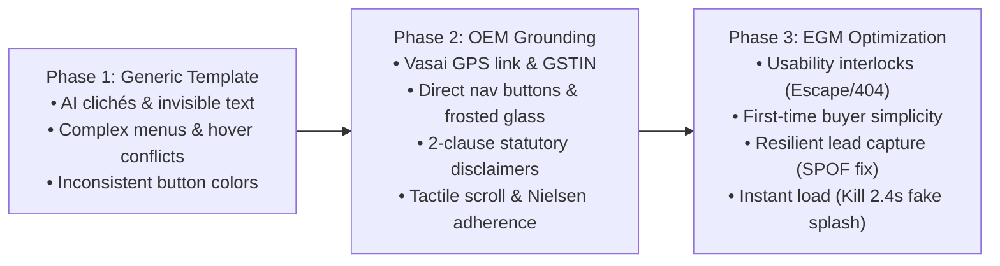
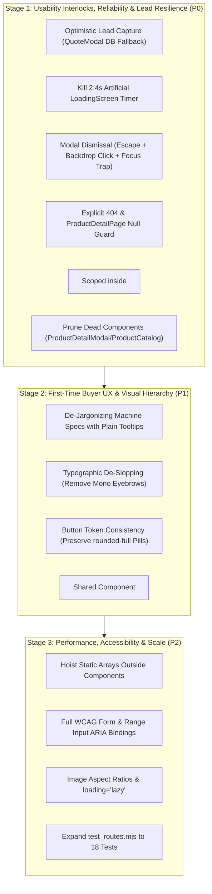

# EGM Concepts Brief & Strategic Evolution Plan (Approved Spec)
**Project**: Vedanta Technologies Industrial Web Platform (`vedanta_website`)  
**Methodology**: Google Elephant-Goldfish Model (EGM) / Spec-Driven Development (SDD)  
**Author**: Anti (Google DeepMind Agent)  
**Status**: ✅ APPROVED BY USER — READY FOR STAGE 1 EXECUTION  
**Revision**: Post-Goldfish Consensus (Incorporating Zoom-Out, Design Critic, and Tech Lead resolutions)

---

## 1. Synthesis & Retrospective: How This Chat & Project Evolved

The project trajectory reflects a transition from a generic, AI-templated machinery site toward a grounded, authentic B2B manufacturing hub for a Vasai-based PET blow moulding OEM.

### Key Milestones & Corrective Lessons Captured in Chat:
1. **First-Time Buyer Core Law**:
   - *User Insight*: Experienced bottlers already know the equipment specifications and buy directly; the website primarily serves first-time entrepreneurs setting up packaged drinking water or soda plants.
   - *Design Impact*: The interface must strip away unnecessary technical obfuscation and present machine sizing, power requirements, and ROI economics in clear, transparent terms.
2. **Elimination of Navigation Fragility**:
   - *User Insight*: Hover-based dropdown menus caused state desynchronization (e.g. hovering over 'Contact' while 'Tools & ROI' remained highlighted).
   - *Design Impact*: Replaced dropdowns with single-click direct route buttons, paired with a persistent frosted-glass floating navbar.
3. **Button Consistency & Visual Dignity**:
   - *User Insight*: Arbitrary styling variations on the Turnkey page (one card filled in blue, another plain white) created an unpolished, "government website" appearance.
   - *Design Impact*: Unified all package cards and primary call-to-actions into an egalitarian, high-contrast industrial theme with established `rounded-full` pill action tokens.
4. **Statutory Pricing Discipline**:
   - *User Insight*: Volatile industrial commodity costs (steel, servo motors, compressors) require clear disclaimers before clients assume listed rates are binding final offers.
   - *Design Impact*: Integrated a mandatory 2-clause statutory notice once at page ends, machine specs, and inquiry forms in small, visible grey text.
5. **Usability & Nielsen Audit Baseline**:
   - Full evaluation across 11 pages and 21 components surfaced critical control flaws (modals lacking Escape/backdrop dismissal, silent 404 routing fallbacks, and artificial load latency).

---

## 2. Saved Interpretation of the Site (Architecture Snapshot)

### Current System Topology:
- **Framework**: React 19.3.1 + React Router 7.18.5 + Vite 8.3.5.
- **Styling**: Tailwind CSS 4.3.4 with custom `@layer base` CSS custom properties and `.industrial-card` definitions.
- **Motion**: `framer-motion` 14.10.1 with reduced-motion accessibility safeguards.
- **Data Model**: Centralized in `src/data/catalog.js` (11 machinery models + utilities) and `src/data/faqs.js`.
- **Validation**: 0 oxlint warnings, 16/16 SSR test routes passing.

### Goldfish Consensus Defect Resolutions:
1. **Lead Capture Single Point of Failure (SPOF)**: Decouple client proposal generation and WhatsApp routing from remote DB latency or failures. Make RFQ submission optimistic.
2. **Fake Loading Latency**: Eliminate the 2,400ms synthetic `setInterval` splash screen timer in `LoadingScreen.jsx` to give visitors immediate access.
3. **Null Product Crash on Slugs**: Implement an early return guard in `ProductDetailPage.jsx` before metadata or breadcrumb evaluations.
4. **Dead Code Elimination**: Prune orphaned `ProductDetailModal.jsx` and `ProductCatalog.jsx`.
5. **Modal Accessibility & Focus/Scroll Lock**: Attach `onClick={onClose}` to outer overlay, listen to physical <kbd>Escape</kbd>, trap tab focus, restore focus on close, and cleanup body overflow safely.
6. **Scoped Error Boundary**: Wrap `<main>` (not root router) with `ErrorBoundary.jsx` so global navigation and WhatsApp stay operational during route exceptions.

---

## 3. Comprehensive 3-Stage Evolution Plan

---

### Stage 1: Usability Interlocks, Reliability & Lead Resilience (P0 — Immediate)

1. **Optimistic & Resilient B2B Lead Capture**:
   - In `QuoteModal.jsx`, wrap `submitRfq` in an optimistic catch block: if database submission fails or times out, locally trigger `downloadProposalSlip(formData)`, alert the user gracefully, and route to WhatsApp with pre-filled specs. Never block proposal download or WhatsApp outreach due to an API timeout.
2. **Bypass 2.4s Artificial LoadingScreen**:
   - Refactor `App.jsx` and `LoadingScreen.jsx` so the page loads immediately without holding visitors on a 2,400ms fake `setInterval` countdown.
3. **Modal Escape, Backdrop Click & Focus Management**:
   - Attach `onClick={onClose}` to backdrop overlay in `QuoteModal.jsx`, keeping `e.stopPropagation()` on the dialog container.
   - Listen to <kbd>Escape</kbd> on window with safe cleanup in `useEffect`.
   - Restore focus to `document.activeElement` on modal close.
   - Apply `touch-action: none` to backdrop to prevent iOS Safari scroll bounce.
4. **Early Null-Guard & Dedicated 404 Screen**:
   - In `ProductDetailPage.jsx`, insert an early null-guard returning a styled "Machine Model Not Found" component with a direct link back to `/machines`.
   - Create `src/pages/NotFoundPage.jsx` and register it under `<Route path="*" />`.
5. **Scoped Error Boundary**:
   - Create `src/components/ErrorBoundary.jsx` and wrap `<Routes>` inside `<main>` in `App.jsx`. Keep `Navbar`, `Footer`, and `MobileBottomNav` outside the boundary so users can navigate and contact sales even if a page throws.
6. **Prune Dead Legacy Files**:
   - Delete `src/components/ProductDetailModal.jsx` and `src/components/ProductCatalog.jsx`.

---

### Stage 2: First-Time Buyer Experience & Typographic De-Slopping (P1)

1. **First-Time Buyer Explanatory Micro-Copy**:
   - Provide interactive tap/hover definitions for technical parameters (BPH, TR, CFM, Petaloid).
   - In `LineConfigurator.jsx`, add a 1-sentence plain summary of required shed space and daily output.
2. **Typographic De-Slopping**:
   - Replace repetitive `font-mono uppercase tracking-wider` eyebrow badges across 18 components with clean, semantic sans-serif badges (`text-xs font-semibold text-blue-700 tracking-normal`).
   - Remove generic `→` trailing arrows from button copy.
3. **Standardize Design Tokens**:
   - Maintain `rounded-full` for all primary interactive actions (pills, buttons, chips); use `rounded-xl`/`rounded-2xl` for container cards.
4. **Unified `<PricingDisclaimer />` Component**:
   - Consolidate inline disclaimer copy into a single, canonical `src/components/PricingDisclaimer.jsx` component.

---

### Stage 3: Performance, Accessibility & Scale (P2)

1. **Data Hoisting & Memory Hygiene**:
   - Extract static configuration arrays declared inside functional component bodies to module level across:
     - `PlantCadFlow.jsx` (`flowSteps`)
     - `TurnkeySolutions.jsx` (`steps`, `packages`)
     - `LocationHubs.jsx` (`hubs`)
     - `WhyChooseVedanta.jsx` (`pillars`, `specsList`)
     - `UnitEconomics.jsx` (`costBreakdown`)
     - `CompliancePage.jsx` (`labEquipMicro`, `labEquipChem`)
     - `ResourceArticles.jsx` (`articles`)
2. **Accessible Form Controls (WCAG 2.1 AA)**:
   - Link all `<input type="range">` elements in `LineConfigurator.jsx` with `<label htmlFor>` and inject `aria-valuemin`, `aria-valuemax`, and `aria-valuenow`.
   - Add `role="radiogroup"` and `role="radio"` with `aria-checked` to custom pill selectors.
   - Connect `<textarea>` in `FastEnquirySection.jsx` and `QuoteModal.jsx` to labels via `id`.
3. **Image Optimization & CLS Prevention**:
   - Set explicit aspect ratios and `width`/`height` attributes on all product renders.
   - Inject `loading="lazy"` on all off-screen catalog images.
4. **Expand Test Coverage**:
   - Update `test_routes.mjs` to test `/404-unknown-url` and `/machine/invalid-slug`, asserting 18/18 tests pass.
