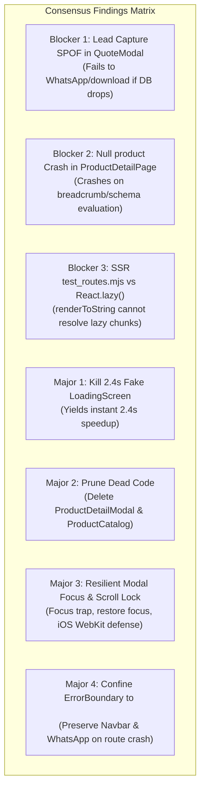

# Goldfish Review Synthesis Report
**Target Document**: `vedanta_website/concepts_brief.md`  
**Review Team**: 
- **Skeptical Architect (`egm-zoom-out`)**
- **Hostile Systems Design Critic (`egm-design`)**
- **Implementation Tech Lead (`egm-implementation-readiness`)**  
**Synthesis Date**: 2026-11-15  
**Evaluation Status**: ❌ Blocked pending architectural resolutions (3 Blockers, 5 Majors, 2 Nits).

---

## 1. Executive Synthesis & Consensus Matrix

All three reviewers independently converged on four fundamental architectural flaws in the proposed plan:
1. **The Lead Capture Single Point of Failure (SPOF)**: In `QuoteModal.jsx`, tying proposal generation and WhatsApp redirection to a remote database response will lose multi-lakh B2B machinery inquiries whenever the database or network drops.
2. **The 2.4-Second Fake Splash Contradiction**: Prioritizing complex `React.lazy()` route splitting to shave 500 kB off a JS bundle while forcing visitors through a 2,400ms synthetic timer in `LoadingScreen.jsx` is an optimization contradiction.
3. **The Null `product` White-Screen Trap**: Naively removing the `|| VEDANTA_CATALOG[0]` fallback in `ProductDetailPage.jsx` without an early null-guard will cause immediate unhandled `TypeError` crashes during metadata and breadcrumb evaluation.
4. **Phantom Work on Dead Code**: `ProductDetailModal.jsx` and `ProductCatalog.jsx` are orphaned, unmounted legacy files. Budgeting engineering effort to make them accessible is an unnecessary YAGNI violation.



---

## 2. Prioritized Findings Detail

### 🔴 Blocker 1: Resilient B2B Lead Pipeline (Hostile Design Critic)
- **Scope**: `QuoteModal.jsx:105-117` & `api/rfq.js`
- **Flaw**: `handleSubmit` halts on any API exception (`submitRfq`). If `DATABASE_URL` is cold, unconfigured, or drops, neither `downloadProposalSlip` nor the WhatsApp handoff screen is triggered. For industrial sales ranging from ₹16.5L to ₹85L, blocking the client from their quotation due to an API error is fatal.
- **Resolution**: Make database persistence optimistic and non-blocking. If the API call fails or times out, locally generate the proposal text slip, alert the user gracefully, and route them to WhatsApp with pre-filled machinery specifications regardless.

### 🔴 Blocker 2: Early Null-Guard on `ProductDetailPage.jsx` (Implementation Tech Lead)
- **Scope**: `ProductDetailPage.jsx:20-78`
- **Flaw**: Removing `|| VEDANTA_CATALOG[0]` causes `product` to evaluate to `undefined` for invalid slugs. Subsequent top-level calculations (`related = filter(m.category === product.category)`, `productSchema`, and `breadcrumbs`) will throw `TypeError: Cannot read properties of undefined` during initial render, crashing the app before any recovery JSX can mount.
- **Resolution**: Place an explicit early return guard immediately after the catalog lookup, before any metadata or related machine filtering:
  ```jsx
  const product = VEDANTA_CATALOG.find(...);
  if (!product) {
    return <MachineNotFound modelCode={modelCode} />;
  }
  ```

### 🔴 Blocker 3: SSR Test Suite & `React.lazy()` Desynchronization (Design Critic & Tech Lead)
- **Scope**: `concepts_brief.md:69,102`, `test_routes.mjs:1-115`
- **Flaw**: React 18/19 synchronous `renderToString()` does not wait for dynamic imports inside `React.lazy()`. It immediately throws or yields only the fallback loading bar. Furthermore, `test_routes.mjs` directly imports page modules rather than testing `<App />`, meaning `App.jsx` and the test harness test different component trees.
- **Resolution**: 
  1. Keep direct module imports for `test_routes.mjs` but expand assertions to test invalid slugs and 404 paths (18 total tests).
  2. If code-splitting `App.jsx`, ensure static pre-rendering or SSR uses an async stream collector (`renderToPipeableStream` with `onAllReady`) rather than synchronous `renderToString`.

---

### 🟠 Major 1: Remove or Bypass the 2.4s Artificial LoadingScreen (Skeptical Architect)
- **Scope**: `App.jsx:26,37` & `LoadingScreen.jsx:9-35`
- **Flaw**: Shaving 500 kB off a JavaScript bundle that parses in 80ms while subjecting every B2B buyer to an artificial 2,400ms splash screen timer (`setInterval` counter to 100%) is an optimization contradiction.
- **Resolution**: Remove the fake timer from `LoadingScreen.jsx` or bypass it immediately once initial DOM mounts, delivering an instant 2.4-second performance improvement on first visit.

### 🟠 Major 2: Prune Dead Legacy Components (Skeptical Architect & Design Critic)
- **Scope**: `ProductDetailModal.jsx` & `ProductCatalog.jsx`
- **Flaw**: Both components are completely unmounted and unused. Active browsing occurs via dedicated routes (`/machines` and `/machine/:modelCode`). Hardening modal accessibility on an orphaned file is wasted sprint capacity.
- **Resolution**: Permanently delete `ProductDetailModal.jsx` and `ProductCatalog.jsx` from `src/components/`. Apply all modal keyboard and backdrop hardening exclusively to `QuoteModal.jsx`.

### 🟠 Major 3: Comprehensive Modal Accessibility & Scroll Architecture (Design Critic & Tech Lead)
- **Scope**: `QuoteModal.jsx:121-125`
- **Flaw**: Naive `document.body.style.overflow = 'hidden'` leaks if unmounted via back button, punches through on iOS Safari touch gestures, causes 15px layout shift on desktop, and lacks keyboard focus trapping (<kbd>Tab</kbd> escapes to background page) and focus restoration on close.
- **Resolution**:
  1. Cleanup overflow styles inside `useEffect` return hook.
  2. Implement a focus trap within `QuoteModal` and restore focus to `document.activeElement` on dismissal.
  3. Attach `onClick={onClose}` to outer overlay, with `e.stopPropagation()` on inner card.
  4. Add `touch-action: none` to backdrop to prevent iOS Safari scroll bounce.

### 🟠 Major 4: Confine ErrorBoundary Blast Radius (Design Critic)
- **Scope**: `App.jsx:45-58`
- **Flaw**: Wrapping the root router in an `ErrorBoundary` will unmount `Navbar`, `Footer`, and `MobileBottomNav` if a page sub-component throws an error, leaving the prospective client with no way to navigate or contact sales.
- **Resolution**: Confine `<ErrorBoundary>` to the `<main>` content container inside `App.jsx`. Keep global navigation and floating WhatsApp controls outside the boundary so the user can always escape a crashed route.

---

### 🟡 Minor Improvements (Nits)
1. **Preserve Established `rounded-full` Pill Tokens**: Keep `rounded-full` for action pills, quick buttons, and filter chips; use `rounded-xl` for cards and modals. Do not arbitrarily force `rounded-lg` on all elements.
2. **Deprioritize 11-Item `useMemo`**: Scrap computational memoization for small static arrays in `LineConfigurator` and `MachinesPage`.

---

## 3. Required Updates to `concepts_brief.md`

Before proceeding to implementation:
1. Revise Stage 1 to include:
   - **Optimistic Lead Ingestion**: Proposal slip download and WhatsApp handoff succeed even if database API fails.
   - **Splash Screen Timer Removal**: Eliminate the 2,400ms artificial delay in `LoadingScreen.jsx`.
   - **Pruning Dead Files**: Delete `ProductDetailModal.jsx` and `ProductCatalog.jsx`.
   - **Null Guard in `ProductDetailPage.jsx`**: Early return before metadata calculations.
   - **Modal Focus Trap & Robust Scroll Lock**: Strict cleanup, focus restoration, and iOS touch isolation.
   - **Main-Scoped ErrorBoundary**: Keep `Navbar` and WhatsApp operational on route crashes.
2. Update Section 4 Verification Matrix to require 18 passing tests in `test_routes.mjs` (including 404 and invalid machine slug).
